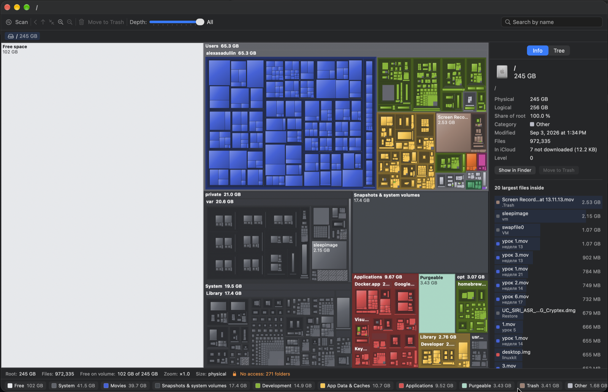
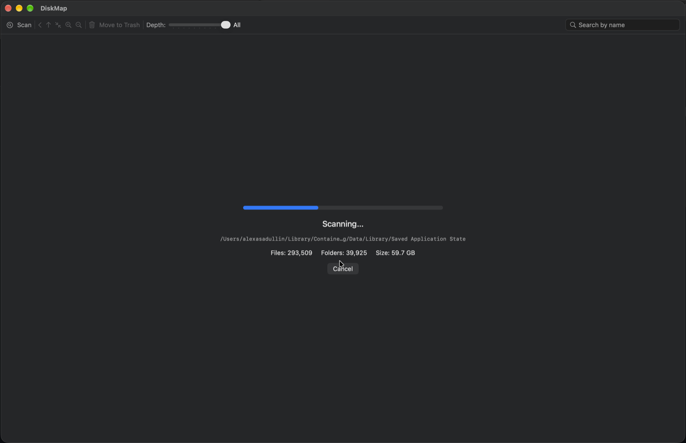

# DiskMap

<a id="download"></a>
## ⬇️ Скачать / Download

### **[Скачать DiskMap.zip](https://github.com/AlexAsadullin/diskmap/releases/latest/download/DiskMap.zip)** · [DiskMap.dmg](https://github.com/AlexAsadullin/diskmap/releases/latest/download/DiskMap.dmg) · [все версии](https://github.com/AlexAsadullin/diskmap/releases)



*Весь диск на одной карте: свободное место, папки пользователя, система, приложения. Справа — инспектор и 20 крупнейших файлов, внизу — легенда категорий с объёмами.*



*Сканирование: прогресс, текущая папка, число файлов и найденный объём.*

macOS 13 Ventura и новее, Apple Silicon и Intel.

1. Скачайте **DiskMap.zip**, откройте его (двойной щелчок) и перетащите **DiskMap.app** в папку **Программы**.
2. Первый запуск. Приложение не нотаризовано Apple, поэтому macOS спросит разрешения один раз:
   - **macOS 15 Sequoia и новее:** откройте DiskMap, в окне предупреждения нажмите **Готово**. Затем **Системные настройки → Конфиденциальность и безопасность**, прокрутите вниз и нажмите **Всё равно открыть** рядом с DiskMap, подтвердите паролем.
   - **macOS 13–14:** щёлкните по DiskMap **правой кнопкой → Открыть → Открыть**.
   - **Или в Терминале:** `xattr -dr com.apple.quarantine /Applications/DiskMap.app`
3. Выдайте **Полный доступ к диску**, чтобы видеть все папки: **Системные настройки → Конфиденциальность и безопасность → Полный доступ к диску → включить DiskMap**.

*English: download **DiskMap.zip**, unzip, drag DiskMap.app to Applications. The app is not notarized: on macOS 15+ open it once, press Done, then go to System Settings → Privacy & Security → **Open Anyway**; on macOS 13–14 right-click → Open. Then grant Full Disk Access.*

---

Нативное приложение для macOS, которое за один взгляд показывает, что занимает место на диске, и позволяет сразу его освободить.

Диск рисуется картой прямоугольников (treemap): **площадь = размер файла**, **цвет = категория папки** (красный — Applications, синий — Movies, жёлтый — Library и т. д.). Можно приближаться к папкам, искать по имени и удалять файлы в Корзину прямо с карты, с отменой через ⌘Z.

*A native macOS disk usage treemap: area is file size, colour is folder category. Zoom, search, and move files to the Trash right from the map. Russian and English UI.*

📖 **[Руководство пользователя — куда нажимать](docs/USER_GUIDE.md)**

## Возможности

- **Честные размеры.** По умолчанию считается физический размер, как у `du`: файлы iCloud, выгруженные в облако, не завышают папки, жёсткие ссылки учитываются один раз. Расхождение с `du -skx` — 0 % на проверочных папках.
- **Быстрое сканирование.** Многопоточный обход через `getattrlistbulk`, примерно вдвое быстрее `du`. Читаются только метаданные, содержимое файлов не открывается, iCloud-файлы не скачиваются.
- **Весь диск целиком.** При сканировании тома карта включает свободное место, purgeable-пространство и снимки Time Machine — сумма блоков равна ёмкости диска.
- **Карта.** Squarified treemap, рамки папок «коробки в коробках», cushion-заливка, подписи, мелкие файлы собираются в блок «Мелкие файлы».
- **Навигация.** Двойной щелчок — войти в папку, строка пути, история назад/вперёд, ползунок глубины 1–10, свободное увеличение до ×64 с мини-картой, жесты трекпада.
- **Инспектор.** Сведения об элементе, 20 крупнейших файлов внутри, дерево папок, синхронизированное с картой.
- **Удаление.** В Корзину с подтверждением и отменой (⌘Z), защита системных файлов, предупреждение для `~/Library`, поиск остатков удалённых приложений, журнал удалений.
- **Ещё.** Поиск по имени, легенда с подсветкой категорий, свои категории и цвета, сохранение результата и сравнение во вкладках, экспорт PNG и CSV, консольный режим, светлая и тёмная темы, VoiceOver.

## Требования

macOS 13 Ventura и новее, Apple Silicon или Intel.

## Установка

Проще всего — скачать готовое приложение (см. [Скачать](#download) в начале страницы). Сборка из исходников (нужны только Command Line Tools, Xcode не обязателен):

```sh
xcode-select --install            # если Command Line Tools ещё не установлены
git clone https://github.com/AlexAsadullin/diskmap.git
cd diskmap
scripts/build_app.sh              # → build/DiskMap.app (arm64 + x86_64)
cp -R build/DiskMap.app /Applications/
```

Консольная команда:

```sh
sudo install -m 755 scripts/diskmap /usr/local/bin/diskmap
diskmap ~/Downloads                     # открыть приложение и просканировать
diskmap --csv ~ --depth 2 > home.csv    # список без интерфейса
```

## Сборка дистрибутива и выпуск

```sh
scripts/build_app.sh                    # build/DiskMap.app, ad-hoc подпись
scripts/make_dmg.sh                     # build/DiskMap.dmg
VERSION=1.0.1 scripts/release.sh        # сборка + DiskMap.zip + DiskMap.dmg + GitHub Release
```

Ссылки «Скачать» в начале README ведут на последний выпуск, поэтому после `release.sh` их менять не нужно.

Подпись Developer ID и нотаризация (тогда пользователям не нужно разрешать запуск вручную):

```sh
xcrun notarytool store-credentials diskmap --apple-id you@example.com --team-id TEAMID
SIGN_IDENTITY="Developer ID Application: Name (TEAMID)" NOTARY_PROFILE=diskmap VERSION=1.0.1 scripts/release.sh
```

## Проверки

XCTest не входит в Command Line Tools, поэтому проверки ядра — отдельная программа:

```sh
swift run -c release diskmap-checks                 # раскладка, категории, сохранение, производительность
swift run -c release diskmap-checks ~/Documents     # плюс сравнение с du -skx для указанных папок
```

## Устройство

| Файл | Что делает |
| --- | --- |
| `Sources/DiskMapCore/DiskScanner.swift` | Многопоточный сканер на `getattrlistbulk`: один том, без симлинков, жёсткие ссылки один раз, без скачивания iCloud |
| `Sources/DiskMapCore/Categories.swift` | Категории и цвета, свои категории, защита системных путей |
| `Sources/DiskMapCore/Treemap.swift` | Squarified treemap, глубина, слияние мелких файлов, отсечение невидимого при увеличении |
| `Sources/DiskMapCore/Renderer.swift` | Отрисовка Core Graphics |
| `Sources/DiskMapCore/Volume.swift` | Свободное, purgeable, снимки Time Machine |
| `Sources/DiskMapCore/Archive.swift`, `CSVExport.swift` | Файл результата `.diskmap`, экспорт CSV |
| `Sources/DiskMap/` | Приложение: окна и вкладки, меню, карта, инспектор, легенда, удаление, настройки, CLI |
| `Sources/DiskMapChecks/` | Самопроверки |

Журнал удалений: `~/Library/Logs/DiskMap/deletions.log`. Сетевых запросов и телеметрии нет.

Исходное техническое задание: [ТЗ визуализатор занятости диска для macOS.md](ТЗ%20визуализатор%20занятости%20диска%20для%20macOS.md).

## Лицензия

[MIT](LICENSE)
